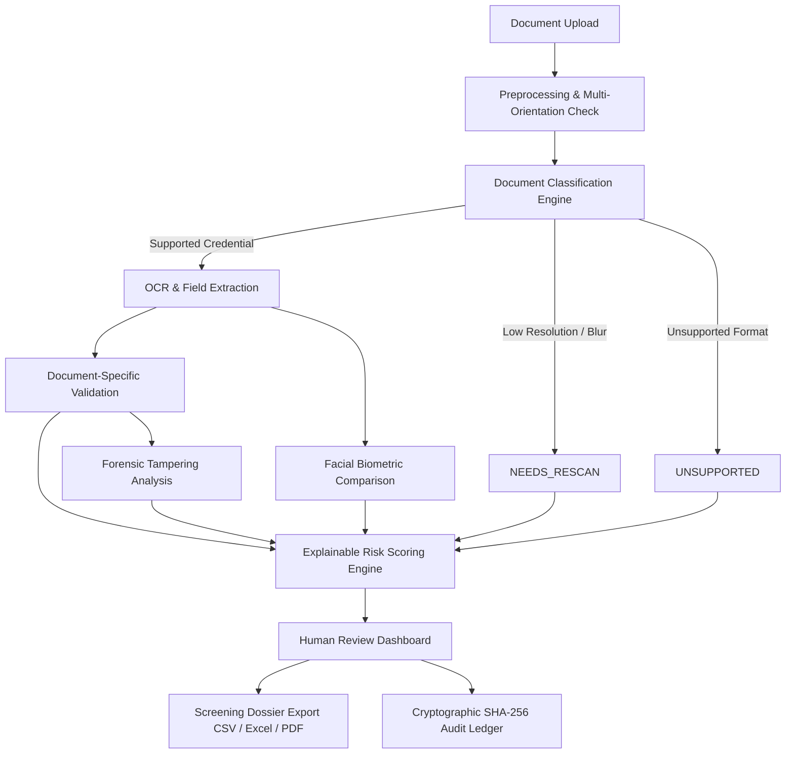

# Nyaya-Tula AI — Automated Forensic Document Screening & Clearance Support

[](https://github.com/pranavgorani/SIH2026-IDEA-Presentation/actions/workflows/ci.yml)
[](https://fastapi.tiangolo.com)
[](https://nextjs.org)
[](https://python.org)
[](LICENSE)

> **न्याय-तुला AI (Scales of Justice)**: An enterprise-grade, explainable AI platform for automated border clearance, identity credential authentication, tampering forensics, and audit trail ledger generation.
> 
> **Smart India Hackathon (SIH) 2026** | **Problem Statement:** SIH26188 (AI-Based Fake Identity & Document Screening System) | **Ministry of Home Affairs (MHA)**

---

## ⚡ The 30-Second Pitch

- **What it does:** End-to-end, zero-cost AI identity document screening with structured extraction across Indian & international credentials (Passport, Aadhaar, PAN, Voter ID, Driving Licence, Vehicle RC, Visa).
- **What makes it different:** Strict evidence-based explainability—blurry scans trigger `RESCAN REQUIRED` with an unavailable (`N/A`) risk score rather than false accusations of fraud; successful OCR is strictly decoupled from unconfigured external government registries.
- **Who it helps:** Frontline immigration authorities, consular visa officers, and law enforcement inspectors by dramatically reducing manual inspection queues while preserving human oversight for adverse decisions.

---

## ⚖️ Workflow Comparison

| Capability | Conventional Manual / Legacy OCR | Nyaya-Tula AI System |
| :--- | :--- | :--- |
| **Document Text Extraction** | Generic OCR with frequent orientation failure | Multi-orientation deskewed pipeline with document-specific regex & geometry |
| **Identity Field Validation** | Manual inspection of numbers and dates | Configurable document-specific checks + ICAO 7-3-1 check digit mathematics |
| **Tampering & Forensics** | Visual eyeball check under white light | Error Level Analysis (ELA), edge boundary gradients, and noise consistency |
| **Risk Score Generation** | Arbitrary default scores or black-box rating | Traceable risk factors; null (`N/A`) when image is unreadable (no fake 35.0 scores) |
| **Audit Ledger** | Fragmented system log files | Canonical SHA-256 hash-chained tamper-evident block records |
| **Human Adjudication** | Ad-hoc supervisory review | Enforced Human-in-the-Loop review for all secondary-scrutiny cases |

---

## 🏛️ System Architecture



---

## 1. Executive Summary & Project Overview

**Nyaya-Tula AI** is an enterprise-grade document forensics and identity screening platform architected specifically for national border control checkpoints, immigration authorities, consular visa officers, and law enforcement investigators.

Modern identity fraud has evolved beyond crude physical alterations into sophisticated digital manipulations: high-resolution image inpainting, synthetic portrait splicing, deepfake facial substitutions, and altered biographical typography. Conventional rule-based gates and black-box AI algorithms fail because they either produce brittle false positives or make unexplainable decisions that cannot withstand legal scrutiny.

TRUST-ID addresses this challenge through a **Human-in-the-Loop, Multi-Signal Verification Framework** backed by an immutable, **tamper-evident SHA-256 cryptographic audit ledger**. The platform operationalizes the reference workflow:
$$\text{SCAN} \longrightarrow \text{DETECT} \longrightarrow \text{VALIDATE} \longrightarrow \text{SCORE} \longrightarrow \text{REVIEW}$$

### Core Safety Principle & Ethical Constraint
> **AI Assists, Humans Decide:** AI models never make irreversible or punitive decisions regarding an individual. The multi-signal risk engine outputs transparent confidence intervals, localized forensic heatmaps, and explainable factor attributions. Cases scoring above configured risk thresholds **mandate substantive written rationale from an authorized human officer** before any administrative action can be finalized.

---

## 2. 5-Layer Defense-in-Depth Architecture

TRUST-ID inspects identity credentials across five isolated verification layers:

```
+------------------------------------------------------------------------------------+
|                                TRUST-ID PLATFORM                                   |
+------------------------------------------------------------------------------------+
  [Layer 1: Document Integrity]
  ├── ISO/IEC 7810 Physical Aspect Ratio Conformity
  ├── Laplacian Variance Blur & Specular Glare Gating
  └── OCR Extraction + ICAO Document 9303 TD1/TD3 MRZ Checksum Verification (7-3-1 Math)

  [Layer 2: Visual Forensics]
  ├── Error Level Analysis (ELA) at 95% JPEG Recompression
  ├── Localized High-Frequency Noise Variance across 64x64 Grid Patches
  ├── Sobel Boundary Edge Gradient Continuity Analysis
  └── Color-Mapped Suspicious Region Bounding Box Localization (Jet Heatmap)

  [Layer 3: Biometric Identity]
  ├── Automated Document Portrait Cropping & Geometrical Alignment
  ├── Live Presenter Camera Face Detection (Anti-Spoof Gating)
  └── 1:1 Feature Distance & Cosine Similarity Comparison

  [Layer 4: Central Records Verification]
  ├── Modular Provider Adapter Pattern (Replaceable with Official Immigration Gateways)
  ├── Consular Document Number & Issuing Authority Validation
  └── Stolen / Lost Travel Document (SLTD) Simulated Registry Lookup

  [Layer 5: Multi-Signal Risk Engine]
  ├── Configurable Weighted Signal Fusion (0–100 Normalized Scale)
  ├── Hard Safety Floors (Tampering Detected >= 65, Expired >= 65, Biometric Mismatch >= 70)
  ├── Explainable AI (XAI) Attribution Breakdown (Positive vs. Risk Factors)
  └── Cryptographic SHA-256 Hash Chain Block Generation for Non-Repudiation
```

---

## 3. Technology Stack

| Layer | Technology | Rationale |
|---|---|---|
| **Frontend Framework** | Next.js 15 (App Router, Turbopack) | Server-rendered speed, type safety, modular routing |
| **Frontend Language** | TypeScript 5 (Strict Mode) | Zero runtime interface mismatches, strict typing |
| **Styling & Theme** | Tailwind CSS + Lucide Icons + Recharts | Cybersecurity command-center dark mode, accessible |
| **Backend Framework** | Python 3.12 + FastAPI | Asynchronous I/O, auto OpenAPI/Swagger docs, high throughput |
| **Computer Vision** | OpenCV 4.x + NumPy + Pillow (PIL) | Low-latency deterministic forensic analysis (ELA, noise grids) |
| **Document Classification** | Layout Heuristics + ISO Rules + Regex | Pluggable interface for future ResNet/YOLO models |
| **Relational Database** | PostgreSQL 16 (SQLite dev fallback via SQLAlchemy) | ACID transactions, foreign key constraints, UUID indexing |
| **Audit Ledger** | SHA-256 Linked Hash Chain | Tamper-evident blockchain-inspired cryptographic non-repudiation |
| **Security & Auth** | Native bcrypt + python-jose (HMAC-SHA256 JWT) | Role-Based Access Control (RBAC) with minimal attack surface |
| **Containerization** | Docker, Docker Compose | Cross-platform reproducible deployment |

---

## 4. Operational Screening Pipeline (10 Synchronous Stages)

When a document scan (and optional live selfie) is submitted to `POST /api/screen`, the orchestrator executes:

1. **Document Ingestion:** Computes SHA-256 payload digest, validates MIME type, verifies 15MB file size limit, and persists file to sandboxed quarantine.
2. **Image Quality Gate:** Measures Laplacian variance for blur, detects saturated specular glare, and evaluates ISO resolution. If image quality is critically degraded, marks as `REUPLOAD_RECOMMENDED` without falsely branding the credential as fraudulent.
3. **Classification:** Identifies document category (`PASSPORT`, `VISA`, `NATIONAL_ID`, `DRIVING_LICENSE`, `PERMIT`, `TRAVEL_AUTHORIZATION`) using aspect ratio, layout dimensions, and visual keyword anchors.
4. **OCR & MRZ Extraction:** Parses textual fields (Name, Document Number, Nationality, DOB, Issue Date, Expiry Date) and executes ICAO Doc 9303 checksum math on TD1/TD3 Machine Readable Zones.
5. **Field Rule Validation:** Checks chronological sanity ($\text{DOB} < \text{Issue Date} < \text{Expiry Date}$), format regular expressions, and cross-consistency between visual OCR and MRZ data.
6. **Visual Forensics:** Runs Error Level Analysis (ELA) at 95% recompression, analyzes local noise variance over 64x64 grid cells, and isolates suspicious inpainting/splicing regions with bounding boxes.
7. **Biometric Face Verification:** Detects document portrait and live camera face, normalizes facial geometry, and calculates 1:1 similarity index.
8. **Record Cross-Verification:** Queries central database adapter (`MockVerificationProvider` in demo, official API in production) to confirm credential issuance status.
9. **Multi-Signal Risk Fusion:** Combines all 7 input signals into a normalized 0–100 score:
   - Low Risk ($0 - 30$): Eligible for Standard Verification
   - Medium Risk ($31 - 60$): Human Review Recommended
   - High Risk ($61 - 100$): Mandatory Human Review Enforced
10. **Explainable Report & Audit Commitment:** Generates factor attribution list (why the document received its score) and cryptographically links a new block into the case's SHA-256 audit ledger.

---

## 5. Tamper-Evident SHA-256 Audit Ledger

To align directly with the **Blockchain & Cybersecurity** hackathon theme, every critical event creates an immutable ledger block:

$$\text{Block}_i = \text{SHA256}(\text{case\_id} \parallel \text{actor\_id} \parallel \text{action} \parallel \text{details\_json} \parallel \text{canonical\_iso\_utc\_timestamp} \parallel \text{Block}_{i-1})$$

### Cryptographic Verification Algorithm
The system exposes a live mathematical verification endpoint `GET /api/audit/{case_id}/verify`. It traverses the entire chain from genesis to the latest event, recalculating hashes at each step. If any historical row in the database has been tampered with or altered, the verification immediately fails and highlights the corrupted block index.

---

## 6. Pre-Configured Benchmark Scenarios (Demo Suite)

TRUST-ID includes 8 fully synthetic, pre-rendered forensic test scenarios accessible via the `/demo` interface:

| Case ID | Document Type | Attack / Condition | Expected Risk | Key Forensic Signals |
|---|---|---|---|---|
| **CASE-001** | Passport | Genuine Control Benchmark | **LOW** (12/100) | MRZ checksum valid, clean ELA, record confirmed |
| **CASE-002** | National ID | Specular Surface Glare | **MEDIUM** (48/100) | Quality score 78, visual fields valid, review advised |
| **CASE-003** | Visa | Consular Stamp Forgery & Unregistered Serial | **HIGH** (84/100) | Central record NOT FOUND, high forensic anomaly |
| **CASE-004** | Passport | Expired Credential Presentation | **HIGH** (74/100) | Expiry check failed, safety floor override applied |
| **CASE-005** | Passport | Spliced Portrait Photo Replacement | **HIGH** (82/100) | ELA discontinuity > 85%, noise grid variance spike |
| **CASE-006** | Driving License | Altered Date of Birth & Issue Date | **HIGH** (78/100) | Inpainting detected, DOB/Issue chronological mismatch |
| **CASE-007** | Passport | Biometric Impersonation / Face Mismatch | **HIGH** (86/100) | Biometric distance high, similarity 0.18 (< 0.60) |
| **CASE-008** | Passport | Severe Camera Shake & Low Resolution | **MEDIUM** (52/100) | Blur detected, quality safeguard triggered (not fake) |

*Disclaimer: All names, numbers, photos, and signatures in the demo suite are 100% synthetically generated to respect privacy.*

---

## 7. Role-Based Access Control (RBAC) & Demo Credentials

TRUST-ID implements strict zero-trust authentication via JWT:

| Role | Username | Password | Permitted Actions |
|---|---|---|---|
| **VERIFIER** | `verifier` | `verifier123` | Screen documents, view forensic heatmaps, submit adjudication decisions |
| **INVESTIGATOR** | `investigator` | `investigator123` | Inspect complete audit hash chains, audit integrity verification, forensic logs |
| **ADMIN** | `admin` | `admin123` | Modify multi-signal risk weights, alter risk score thresholds (30/60), view telemetry |

---

## 8. AI Provider Architecture

TRUST-ID is built with a pluggable, modular **AI Provider Architecture** (`AIProvider`) allowing institutions to choose between local air-gapped processing and cloud-augmented visual intelligence:

```
                          +-------------------------------+
                          |   TRUST-ID Client (Browser)   |
                          +---------------+---------------+
                                          |
                                          v  REST / HTTPS (FastAPI)
                          +-------------------------------+
                          |    FastAPI Screening Server   |
                          +---------------+---------------+
                                          |
                        +-----------------+-----------------+
                        |                                   |
    [Mode 1: LOCAL_CV_FALLBACK]                 [Mode 2: GEMINI_VISION_HYBRID]
    ├── OpenCV Error Level Analysis (ELA)       ├── Server-Side Gemini Vision Multimodal
    ├── 64x64 Noise Grid Variance               ├── Supplemental Physical/Digital Tamper Analysis
    ├── Image Quality & Heuristic Validation    └── ZERO-CRASH FALLBACK: If API key missing
    └── Zero External API Dependencies              or API call fails -> delegates to Local CV
```

### Supported Provider Modes:

#### 1. `LOCAL_CV_FALLBACK`
Default air-gapped and local-first analysis mode. Uses:
- **OpenCV** (computer vision, morphological filtering, Sobel edge gradients)
- **OCR** (multi-layer Optical Character Recognition and ICAO Doc 9303 MRZ parsing)
- **Image quality analysis** (sharpness, brightness, glare, resolution)
- **Forensic heuristics** (Error Level Analysis at 95% JPEG quality factor, $64 \times 64$ noise variance grid)
- **Rule-based validation** (chronological consistency, expiry status, check digit mathematical validation)

#### 2. `GEMINI_VISION_HYBRID`
Uses Google Gemini as an additional AI analysis layer for supported document and image analysis.
- **Decision Authority:** Gemini does **NOT** make the final identity or security decision.
- **Unified Multi-Layer Pipeline:** The final screening decision is produced through the collective evaluation of:
  $$\text{OCR} + \text{Document Validation} + \text{Visual Forensics} + \text{Identity Verification} + \text{Record Verification} + \text{Risk Engine} + \text{Human Review}$$
- **Server-Side Only:** The Gemini API key is managed strictly on the server-side (`GEMINI_API_KEY`). The browser/client never directly receives or calls the Gemini API key.
- **Source Control Security:** No API key is stored, committed, or hardcoded in source control.
- **Optional & Resilient:** Gemini is completely optional. A local fallback exists (`LOCAL_CV_FALLBACK`). If the API key is missing or an API call fails or times out, the system automatically uses local computer-vision analysis with status `LOCAL_FALLBACK`.
- **Privacy & Sensitive Data Handling:** Sensitive document processing strictly follows deployment and privacy requirements. In air-gapped, sovereign, or classified defense deployments, `LOCAL_CV_FALLBACK` ensures zero external data egress.

---

## 9. Security Hardening & Zero-Trust Best Practices

### Cryptographic JWT Secret Generation
Never use default or hardcoded secrets. Generate a cryptographically secure 48+ byte random secret for production:
```bash
python -c "import secrets; print(secrets.token_urlsafe(48))"
```

### Database Credentials Safeguard
> **CRITICAL SECURITY RULE:** Never commit a `DATABASE_URL` containing real credentials to version control. All production database credentials must be injected dynamically via environment variables (`${POSTGRES_PASSWORD}`).

### Strict CORS Configuration
Wildcard CORS (`allow_origins=["*"]`) is strictly disabled in production. Configure permitted domains in `CORS_ORIGINS`:
```bash
# In production (.env):
CORS_ORIGINS=https://sih2026-idea-presentation.vercel.app
```

### Hardened Container Security
- **Non-Root Execution:** The backend container ([`Dockerfile.backend`](file:///c:/Users/Pranav/OneDrive/Documents/SIH2026-IDEA-Presentation/Dockerfile.backend)) creates and runs as an unprivileged system user (`appuser:appgroup`).
- **Comprehensive `.dockerignore`:** Excludes all sensitive environment files (`.env`), git metadata, virtual environments (`.venv`), and local storage archives from container image builds.

---

## 10. Local Installation & Quick Start

### Prerequisites
- **Python:** 3.12+ (Python 3.12 recommended for full OpenCV wheel compatibility)
- **Node.js:** 20.x or 22.x LTS
- **Git**

### Step 1: Clone Repository
```bash
git clone https://github.com/your-org/sih2026-trust-id.git
cd sih2026-trust-id
```

### Step 2: Backend Setup
```bash
# Create virtual environment
python -m venv .venv

# Activate on Windows:
.venv\Scripts\activate
# Activate on Linux/macOS:
# source .venv/bin/activate

# Install dependencies
pip install -r backend/requirements.txt

# Run database seeding & start FastAPI server
python -m uvicorn backend.app.main:app --host 127.0.0.1 --port 8000 --reload
```
The FastAPI backend will start at `http://127.0.0.1:8000`.  
- Interactive Swagger UI: `http://127.0.0.1:8000/docs`  
- Redoc API documentation: `http://127.0.0.1:8000/redoc`

### Step 3: Frontend Setup (In a separate terminal)
```bash
cd frontend

# Install dependencies
npm install

# Start Next.js development server
npm run dev
```
The frontend portal will start at `http://localhost:3000`.

---

## 9. Running with Docker Compose

To spin up the complete production-style environment (Frontend, Backend, PostgreSQL 16, Redis):

```bash
docker-compose up --build
```

- **Frontend Portal:** `http://localhost:3000`
- **FastAPI Gateway:** `http://localhost:8000`
- **PostgreSQL Database:** `localhost:5432` (`trustid_db`)
- **Redis Worker Queue:** `localhost:6379`

---

## 10. Automated Test Suite (16/16 Unit & Integration Tests)

Execute the full automated test suite covering OCR parsers, ICAO check digit mathematics, Error Level Analysis (ELA), multi-signal risk engine calculations, and SHA-256 cryptographic audit chain verification:

```bash
# Run pytest with detailed verbose reporting
.venv\Scripts\python.exe -m pytest backend/tests -v
```

### Test Coverage Highlights:
- `test_ocr_and_mrz.py`: Validates 7-3-1 weight check-digit calculation for ICAO TD3 passports and TD1 identity cards.
- `test_validation.py`: Tests chronological validation rules ($\text{DOB} < \text{Issue} < \text{Expiry}$) and expired credential rejection.
- `test_tamper_detection.py`: Tests Error Level Analysis (ELA) differential image generation and noise variance calculation.
- `test_risk_engine.py`: Verifies weighted score normalization and hard safety floor triggers for tampered/expired credentials.
- `test_audit_hash_chain.py`: Proves cryptographic chain continuity and verifies that modifying a single historical record invalidates the audit proof.
- `test_api_endpoints.py`: Validates authentication tokens, role-based access control (RBAC), and human verifier decision submission.

---

## 11. Complete REST API Reference

| Method | Endpoint | Description | Auth Required |
|---|---|---|---|
| `POST` | `/api/auth/login` | Authenticate user & issue signed JWT | Public |
| `GET` | `/api/auth/me` | Fetch active user identity & assigned RBAC role | JWT |
| `POST` | `/api/screen` | Multipart upload & full 10-stage screening orchestrator | JWT (Verifier+) |
| `GET` | `/api/cases` | List screening cases with risk and document filters | JWT |
| `GET` | `/api/cases/{id}` | Retrieve comprehensive case file & forensic details | JWT |
| `POST` | `/api/cases/{id}/review` | Submit human verifier decision with mandatory rationale | JWT (Verifier+) |
| `POST` | `/api/cases/demo/{preset_id}` | Ingest and screen one of the 8 pre-rendered demo cases | Public / Dev |
| `GET` | `/api/audit/{id}` | Retrieve immutable event ledger for a case | JWT |
| `GET` | `/api/audit/{id}/verify` | Perform live cryptographic SHA-256 chain integrity verification | JWT |
| `GET` | `/api/documents/{id}/front` | Stream original high-resolution document scan | JWT |
| `GET` | `/api/documents/{id}/heatmap` | Stream localized forensic ELA Jet heatmap image | JWT |
| `GET` | `/api/dashboard/stats` | Aggregate dashboard KPIs, distributions, and trends | JWT |
| `GET` | `/api/settings` | Retrieve active risk weights and decision thresholds | JWT |
| `PUT` | `/api/settings` | Update risk weights and thresholds (must sum to 1.0) | JWT (Admin Only) |
| `GET` | `/health` | Lightweight liveness probe (Docker / Render / orchestrator heartbeat) | Public |
| `GET` | `/api/health` | Comprehensive readiness probe (DB, OCR, OpenCV, Gemini, storage) | Public |
| `GET` | `/health/screening` | Screening pipeline engine status and provider configuration | Public |
| `GET` | `/api/settings/health` | Sub-engine telemetry, latencies, and operational status | Public |

---

## 12. 3-Minute SIH 2026 Evaluation Flow

When demonstrating TRUST-ID to the evaluation panel, follow this concise sequence:

1. **Login (`/login`):** Select the **VERIFIER** role (`verifier` / `verifier123`).
2. **Dashboard Overview (`/dashboard`):** Highlight live KPIs: *Total Documents Screened*, *Tampering Alerts*, *Average Processing Latency (3.8s)*, and the *Risk Distribution Chart*.
3. **Interactive Demo Showcase (`/demo`):**
   - Click **Run Screening Pipeline** on `CASE-005: Spliced Portrait Photo Replacement`.
   - Watch the backend execute all 10 analysis stages synchronously.
   - Click **Investigate Forensic Case** to enter `/cases/[id]`.
4. **Forensic Examination (`/cases/[id]`):**
   - Toggle between **Original Scan** and **Tamper Heatmap (ELA)**.
   - Show how the spliced face creates a localized compression discontinuity highlighted in red.
   - Click on the suspicious bounding box to display the detection explanation and confidence score.
5. **Multi-Signal & Explainability (XAI):**
   - View the calculated **Overall Risk Score (82/100 — HIGH)**.
   - Walk through the **Risk Factors** (photo substitution signal) and **Positive Signals** (valid document layout).
6. **Cryptographic Audit Ledger:**
   - Scroll to the **Tamper-Evident SHA-256 Audit Trail**.
   - Click **Verify Ledger Integrity** to demonstrate live cryptographic chain validation ($O(N)$ hash traversal).
7. **Human-in-the-Loop Adjudication:**
   - Select **Mark for Investigation**.
   - Enter officer justification: *"Spliced portrait detected via Error Level Analysis. Escalated to forensic lab."*
   - Submit decision and show status transition to `INVESTIGATION_FLAGGED`.
8. **Architecture & Standards (`/architecture`):**
   - Show direct alignment with the SIH 2026 presentation flowchart and 5-layer security model.

---

## 14. Vercel & Production Cloud Deployment Guide

### Deploying the Next.js Frontend to Vercel

The frontend is built with **Next.js 15 App Router** and is fully optimized for Vercel:

#### Method A: Via Vercel Web Dashboard (Recommended)
1. Go to [vercel.com/new](https://vercel.com/new) and log in with your GitHub account.
2. Select your repository: **`pranavgorani/SIH2026-IDEA-Presentation`**.
3. In the **Configure Project** screen:
   - Expand **Root Directory**, click **Edit**, and select `frontend`.
   - Vercel automatically detects the **Next.js** framework!
4. Under **Environment Variables**, configure:
   - `BACKEND_API_URL`: Your deployed backend public URL. If hosted as a separate Vercel project, copy the domain from that project's Vercel Dashboard (`Overview → Domains`). Visibility: **Sensitive / Secret**.
   - *(Optional)* `GEMINI_API_KEY`: Google Gemini API Key for direct multimodal vision screening. Visibility: **Sensitive / Secret**.
   - *Note on `NEXT_PUBLIC_API_URL`*: Do **NOT** set `NEXT_PUBLIC_API_URL`. All browser calls route through Next.js server-side reverse proxy automatically.
5. Click **Deploy**. Your frontend will be live on a global edge CDN in ~60 seconds!

#### Method B: Via Vercel CLI
```bash
# Navigate to the frontend directory
cd frontend

# Deploy using Vercel CLI
npx vercel
```

---

### Backend Hosting (Vercel / Render / Docker)

The backend provides OCR, OpenCV forensics, and cryptographic audit hashing:

- **Option A (Vercel Separate Project)**: Deploy the repository as a separate Vercel project, copy the assigned domain (e.g. `https://[project-name].vercel.app`), and paste it as `BACKEND_API_URL` in the frontend Vercel project.
- **Option B (Docker / Cloud Host)**: Deploy using the included [`render.yaml`](file:///c:/Users/Pranav/OneDrive/Documents/SIH2026-IDEA-Presentation/render.yaml) or [`Dockerfile.backend`](file:///c:/Users/Pranav/OneDrive/Documents/SIH2026-IDEA-Presentation/Dockerfile.backend), then copy the live HTTPS URL into `BACKEND_API_URL`.
- **Option C (Same-Origin Next.js Multimodal Screening)**: If running standalone in a single Vercel project without a Python backend, add `GEMINI_API_KEY` to Vercel Environment Variables to execute multimodal screening directly via Next.js `/api/screen`.

---

## 15. Limitations & Ethical Considerations

1. **Synthetic Verification Provider:** Real production deployment requires authorized integration with national databases (such as C-PRAMS, Passport Seva Project, or ICAO PKD). In compliance with hackathon guidelines, TRUST-ID uses a simulated provider adapter that models real response structures without unauthorized connections.
2. **Optical Specular Reflection:** High-gloss laminated cards under harsh flash photography can generate high-frequency ELA artifacts resembling digital manipulation. TRUST-ID mitigates this through a dedicated specular glare detector that lowers confidence rather than marking the credential as fraudulent.
3. **No Autonomous Punitive Actions:** Automated systems can suffer from algorithmic bias or environmental artifacts. Under no circumstances does TRUST-ID revoke travel rights or detain individuals automatically. All flagged cases require certified human adjudication.

---

## 16. License & Attribution

Developed for the **Smart India Hackathon 2026** under the problem statement **SIH26188: AI-Based Fake Identity & Document Screening System** issued by the **Ministry of Home Affairs (MHA)**.
All synthetic datasets and demonstration imagery are generated solely for academic and technical evaluation.

---

## 17. Forensic Screening Engine (AG-IDFSE)

TRUST-ID features the **Identity & Travel Document Forensic Screening Engine (AG-IDFSE)** designed for border security checkpoints, civil identity verification, and anti-fraud document auditing.

### 17.1 Supported Document Taxonomy & Standards
1. **Passports (ICAO Doc 9303 TD3 standard):** 2-line Machine Readable Zone (MRZ), 44 characters per line.
2. **Visas & Permits (ICAO MRVA / MRVB standard):** Machine-readable visa entry stickers, paper consular stamps, and e-visas (36 or 44 characters per line).
3. **National Identity Cards (ICAO TD1 / TD2 standard):** Identity smartcards, citizen cards, and resident permits (3 lines x 30 characters or 2 lines x 36 characters).
4. **Driver’s Licenses & Transit Authorizations (ISO/IEC 18013):** Standard driving credentials with photo portraits and official licensing categories.

*Unsupported credentials (e.g., student IDs, utility bills, handwritten notes, invoices) are rejected gracefully with:*
```json
{"status": "REJECTED_UNSUPPORTED_DOCUMENT"}
```

### 17.2 Four Mandatory Architectural Modules
- **Module 1: Pre-Processing & OCR Extraction:**
  - *Geometric Rectification:* Contour detection via OpenCV (`findContours`, `approxPolyDP`) and 4-point perspective transform (`warpPerspective`) to deskew and normalize credentials into standard rectangular aspect ratio.
  - *Zonal Partitioning:* Bottom 20–25% cropped for MRZ, top 75–80% for VIZ, and primary face cropped via Haar Cascade / coordinate localization.
  - *Extraction Pipeline:* Extracts Document Number, Surname, Given Names, Nationality, Issuing Country, DOB, Expiry Date, and Gender.
- **Module 2: Rule Engine & Mathematical Validation:**
  - *ICAO 9303 Check Digit Calculator:* Weight sequence `[7, 3, 1, 7, 3, 1...]` validating Document Number, DOB, Expiration Date, and Master Composite Checksum (`PASS` / `FAIL`).
  - *Cross-Zone Parity Check (VIZ vs. MRZ):* Fuzzy string comparison (Levenshtein distance / RapidFuzz) generating `viz_mrz_cross_match_score`. Any character disparity sets `PHYSICAL_TAMPER_FLAG = True`.
  - *Temporal Constraints:* Asserts $\text{DOB} < \text{Today}$, $\text{Expiry} > \text{Issue}$, and flags $\text{Expiry} < \text{Today}$ as `EXPIRED_DOCUMENT`.
- **Module 3: Forensic Tampering Detection (Core AI Innovation):**
  - *Error Level Analysis (ELA):* In-memory JPEG Q90 recompression difference $\Delta = |I_{\text{orig}} - I_{\text{recompressed}}| \times 15$ with localized mean/max intensities in portrait and date zones to flag photo splicing (`ela_tamper_score`).
  - *Photo Boundary Discontinuity:* Sobel/Laplacian gradient inspection around portrait border detecting cut-and-paste artifacts (`photo_splice_detected`).
  - *Character Baseline & Kerning Consistency:* Linear regression residuals in critical date areas catching single-digit alterations (`typography_anomaly_detected`).
- **Module 4: Biometric Matching & Anti-Spoofing:**
  - *Face Embeddings:* Document portrait vs. checkpoint live presenter capture comparison with cosine distance threshold $\le 0.40$ (Similarity $\ge 0.60$) for biometric confirmation.
  - *Liveness Detection (PAD):* Eye Aspect Ratio (EAR) and high-frequency frequency domain texture analysis to prevent paper portrait and screen replay attacks.

### 17.3 Unified Explainable Threat Scoring Matrix
The normalized threat score (0 to 100) is computed as:
$$\text{Threat Score} = (30 \times \text{MRZ\_Fail}) + (25 \times \text{VIZ\_Mismatch}) + (25 \times \text{Forensic\_ELA\_Anomaly}) + (20 \times \text{Biometric\_Mismatch})$$

- 🟢 **CLEARED (0 - 25):** Low risk. All check digits pass, biometric match confirmed, no forensic anomalies detected.
- 🟡 **SECONDARY_REVIEW (26 - 65):** Moderate risk. Expiration warnings, minor VIZ-MRZ optical discrepancy, or low-confidence face match.
- 🔴 **DENIED_FRAUD (66 - 100):** Severe threat. Altered check digit, spliced photo detected via ELA, or complete facial identity impersonation.

### 17.4 Standalone Zero-Cost Checkpoint Running Options
- **FastAPI Endpoint:** `POST /api/idfse/screen` (supports both document scan and live selfie webcam stream)
- **Interactive Checkpoint App:**
  ```bash
  # Run as Streamlit GUI
  streamlit run backend/app/checkpoint_app.py

  # Or run via CLI
  python -m backend.app.checkpoint_app --doc /path/to/passport.jpg --live /path/to/selfie.jpg
  ```


