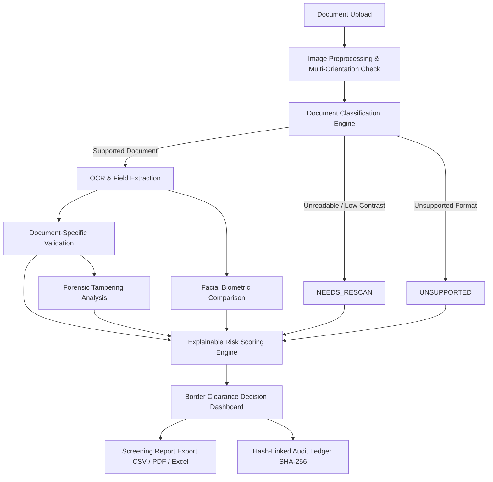

# Nyaya-Tula AI — System Architecture

Nyaya-Tula AI (न्याय-तुला: "Scales of Justice") is an AI-powered document screening, tampering detection, and border clearance decision support system developed for the Smart India Hackathon (SIH) 2026.

## 1. High-Level Architecture

## 2. Core Architectural Principles

1. **Document-Specific Extraction & Validation**:
   - Pan cards use Income Tax alphanumeric rules (`[A-Z]{5}[0-9]{4}[A-Z]`).
   - Aadhaar cards support both 12-digit standard and masked formats (`XXXX XXXX 1234`).
   - Passports parse ICAO Doc 9303 TD3 2-line MRZ and evaluate 7-3-1 repeating check digits.
   - Voter ID uses Election Commission EPIC syntax; Driving Licences use SARATHI/Parivahan structures.
   - No cross-pollution: PAN cards are never evaluated against passport MRZ rules.

2. **Strict Separation of OCR and External Verification**:
   - Successful local OCR extraction results in `ocr_status: "COMPLETED"`.
   - External official database lookups (e.g., NSDL, UIDAI) remain `external_verification_status: "NOT_VERIFIED"` unless an authorized live integration is configured.
   - An unconfigured external API never triggers a fraud risk finding.

3. **Ground-Truth Risk Evaluation**:
   - If document classification fails or an image is blurred, `risk_score` is set to `null` (displayed as `N/A`), preventing misleading arbitrary fraud scores.
   - High risk is generated exclusively from verifiable forensic discrepancies (checksum mismatches, ELA compression anomalies, blacklists).

4. **Cryptographic Tamper-Evident Ledger**:
   - Each scan transaction is hashed using canonical SHA-256 and chained to predecessor blocks, creating an immutable audit trail without external blockchain overhead.
